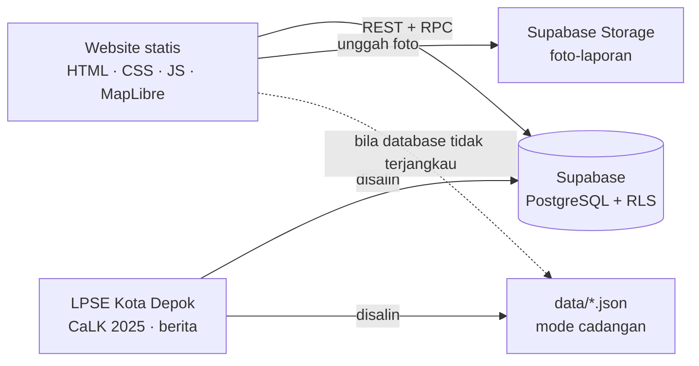
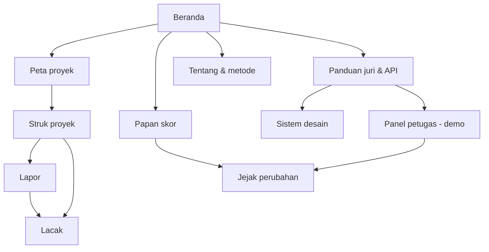

# Tally — Cocok di dokumen, cocok di lapangan

Tally mencocokkan anggaran proyek Pemkot Depok (data LPSE dan CaLK) dengan foto dan GPS dari warga, menggabungkan laporan untuk masalah yang sama menjadi satu kasus, lalu melacak tindak lanjutnya sampai selesai.

- **Website:** https://tally-depok.vercel.app
- **Panduan pengujian, PIN demo, dan API:** https://tally-depok.vercel.app/panduan
- **Lomba:** Web In Action, Multimedia In Action 2026 — subtema *Civic Reporting & Accountability*

> *To tally* berarti "cocok". Seperti tally stick yang dibelah dua, Tally menaruh catatan resmi ("kata dokumen") berdampingan dengan bukti warga ("kata warga"), lalu memberi stempel: cocok, tidak cocok, atau belum dicek. Proyek ini sebelumnya bernama **Wujud** (nama saat First Draft).

## Fitur utama

| Fitur | Halaman |
|---|---|
| Struk Belanja Kota (realisasi APBD 2025) dan meter anggaran vs realisasi | Beranda |
| "Proyek yang paling perlu dicek", dipilih otomatis dari sinyal data | Beranda |
| Peta 24 proyek: warna = status lapangan, bentuk = ketepatan lokasi; pencarian dengan saran yang tahan salah ketik, panel kiri yang bisa dilipat, tautan rute Google Maps, titik "lokasiku", urutan "terdekat dari lokasiku" | Peta proyek |
| Struk proyek vs laporan warga dengan stempel status, sinyal kontrak < 80% HPS, peta radius cek GPS | Struk proyek |
| Lapor: kondisi, temuan, foto langsung dari kamera dengan cap waktu, lokasi saat memotret, cek bukti (foto langsung + akurasi GPS ≤ 100 m + radius 300/1.500 m), tanpa nama dan NIK | Lapor |
| Laporan ganda digabung menjadi satu kasus; hitungan warga sekali per perangkat, baik lewat "Saya juga lihat ini" maupun laporan lengkap | Struk proyek, Lapor |
| Lacak ala resi: linimasa status, batas 7 hari, foto sebelum/sesudah, tanggapan petugas | Lacak |
| Panel petugas (PIN demo): bukti foto dan jarak GPS, verifikasi, teruskan, tolak, selesaikan | Panel petugas |
| Papan skor per dinas, kecamatan, dan penyedia (dihitung per kasus) | Papan skor |
| Jejak perubahan publik: setiap perubahan, penghapusan (wajib beralasan), dan suntingan langsung di database tercatat otomatis oleh trigger dan tidak bisa dihapus | Jejak perubahan |
| Latar belakang berdata, metode, privasi; panduan juri; sistem desain | Tentang, Panduan, Sistem desain |
| Database bersama + mode cadangan otomatis bila database tidak terjangkau | Semua |

## Tech stack

- **Frontend:** HTML, CSS (sistem desain sendiri, tanpa framework), JavaScript murni
- **Database:** [Supabase](https://supabase.com) — PostgreSQL dengan Row Level Security, 6 fungsi RPC, trigger jejak perubahan, Storage untuk foto
- **Peta:** MapLibre GL JS 5.24 (di-host sendiri) + peta dasar [OpenFreeMap](https://openfreemap.org) gaya Positron yang diredam (data © OpenStreetMap), cadangan [VersaTiles](https://versatiles.org). Tanpa kunci API.
- **Huruf:** Plus Jakarta Sans dan IBM Plex Mono (SIL OFL, di-host sendiri)
- **Hosting:** Vercel

## Cara menjalankan

1. **Clone**
   ```bash
   git clone https://github.com/dimazazriel/Tally.git
   cd Tally
   ```
2. **Install:** tidak perlu. Tidak ada build step dan tidak ada `npm install`.
3. **Run:** buka folder di VS Code → klik kanan `index.html` → **Open with Live Server**, atau jalankan `python -m http.server 8080` lalu buka http://localhost:8080.

Website langsung memakai database Tally di Supabase. Untuk mencoba tanpa database, kosongkan `supabaseUrl` di `js/config.js`: Tally otomatis masuk **mode cadangan** (proyek dari `data/proyek.json`, laporan disimpan di browser).

### Memakai database sendiri

1. Buat project di Supabase (Data API aktif).
2. Buka **SQL Editor**, tempel seluruh `supabase/schema.sql`, lalu **Run**. Isinya: 6 tabel, RLS, 6 fungsi, trigger jejak perubahan, bucket foto, 24 proyek, dan PIN demo petugas `404404`.
3. Atur PIN admin tim lewat SQL Editor (jangan disimpan di repo):
   ```sql
   insert into public.pengaturan (kunci, nilai)
   values ('pin_admin_hash', tally_privat.hash_pin('PIN-RAHASIA-KALIAN'))
   on conflict (kunci) do update set nilai = excluded.nilai;
   ```
4. Isi `supabaseUrl` dan **publishable key** (`sb_publishable_...`) di `js/config.js`. Jangan pernah memasang secret key di website.
5. Sudah pernah menjalankan `schema.sql` versi lama? Jalankan ulang file terbaru; aman diulang dan data yang ada tidak hilang.
6. Setelah penjurian, matikan PIN demo agar tidak ada lagi yang bisa mengubah status kasus:
   ```sql
   delete from public.pengaturan where kunci = 'pin_petugas_hash';
   ```

## Arsitektur dan database



| Tabel | Isi | Akses publik |
|---|---|---|
| `proyek` | 24 paket resmi: pagu, HPS, kontrak, penyedia, dinas, koordinat, presisi lokasi | baca |
| `laporan` | kondisi, temuan, foto, `foto_langsung`, jarak dan akurasi GPS, `terverifikasi`, status, `induk_kode` (gabungan laporan ganda), jumlah dukungan | baca |
| `riwayat` | setiap perubahan status dan catatan petugas | baca |
| `dukungan` | "Saya juga lihat ini", unik per kasus per perangkat | tidak ada |
| `jejak` | catatan otomatis setiap perubahan, penghapusan, dan data yang dimasukkan langsung ke `laporan` dan `proyek`: kolom lama → baru, jalur (petugas, admin, dasbor database, skrip), alasan; tidak bisa diubah atau dihapus | baca |
| `pengaturan` | hash PIN petugas dan admin | tidak ada |

Semua penulisan lewat fungsi yang memeriksa isinya: `kirim_laporan`, `dukung`, `lacak`, `cek_pin`, `perbarui_kasus`, `hapus_laporan` (wajib alasan). Trigger `catat_jejak` mencatat setiap perubahan ke tabel `jejak`, termasuk yang dilakukan langsung lewat dasbor Supabase. Lokasi pelapor tidak disimpan; database hanya menyimpan jaraknya ke titik proyek.

## Sitemap



## Struktur folder

```
index.html, peta.html, detail.html, lapor.html, lacak.html, skor.html,
jejak.html, petugas.html, tentang.html, panduan.html, desain.html, 404.html
css/style.css          sistem desain "struk & stempel" (token di :root)
js/config.js           alamat database + publishable key + tautan pendukung
js/data.js             satu pintu data: Supabase atau mode cadangan
js/util.js             format angka, logika kasus, stempel, sinyal, SLA
js/layout.js           ikon, filter tinta stempel, status database
js/peta-dasar.js       peta MapLibre: gaya peta, penanda, kontrol, lokasiku
js/<halaman>.js        skrip tiap halaman
data/                  proyek.json, apbd.json, data mentah LPSE, SUMBER-DATA.md
supabase/schema.sql    skema database lengkap
assets/                logo, favicon, huruf, MapLibre
```

## Progres (Final Submission, 11 November 2026)

- [x] Beranda: Struk Kota, meter anggaran, proyek yang perlu dicek, laporan terbaru
- [x] Peta 24 proyek dengan status lapangan, saringan, dan urutan
- [x] Struk proyek vs kata warga dengan stempel dan sinyal data
- [x] Formulir lapor dengan kamera langsung, cek bukti (foto + GPS + radius), batas jumlah laporan, dan penggabungan laporan ganda
- [x] "Saya juga lihat ini" dan model kasus
- [x] Lacak dengan batas 7 hari dan foto sebelum/sesudah
- [x] Panel petugas berbasis PIN, papan skor per dinas/kecamatan/penyedia
- [x] Jejak perubahan publik yang dicatat trigger database (termasuk suntingan lewat dasbor)
- [x] Database Supabase dengan RLS dan fungsi, plus mode cadangan
- [x] Halaman Tentang, Panduan juri, Sistem desain, dan 404
- [ ] Laporan lapangan asli dari kunjungan tim (bertanda "tim" di database)

## Catatan data

- Realisasi APBD 2025: CaLK Pemerintah Kota Depok TA 2025 (PPID Kota Depok)
- 21 proyek: LPSE Kota Depok (spse.inaproc.id/depok); 3 proyek jalan/drainase: berita resmi DPUPR
- Laporan warga: kunjungan lapangan tim dan warga, tersimpan di database
- Rincian lengkap dan cara mengecek ulang: [`data/SUMBER-DATA.md`](data/SUMBER-DATA.md)

## Tim error 404

- Atilla Majid Hartono — UI dan beranda
- Muhammad Naufal Hefzie — peta dan logika
- Dimaz Azriel Prayayewa — data dan cerita
