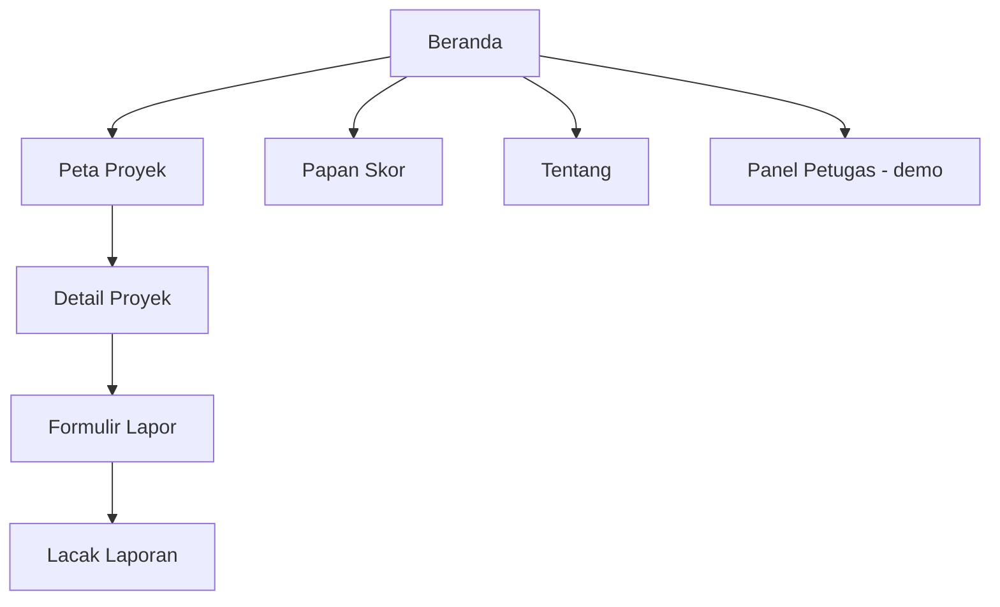

# Tally — Cocok di dokumen, cocok di lapangan

Tally mencocokkan data anggaran proyek pemerintah dengan bukti lapangan dari warga, lalu melacak tindak lanjutnya sampai selesai.

> *To tally* berarti "cocok". Tally mencocokkan catatan resmi anggaran dengan bukti dari lapangan.
> Proyek ini sebelumnya bernama **Wujud** (nama pada First Draft).

**Demo:** https://dimazazriel.github.io/wujud/

## Tech stack
- HTML, JavaScript, Tailwind CSS (CDN)
- Leaflet.js + OpenStreetMap — peta proyek
- Chart.js — grafik Struk Kota & Papan Skor
- JSON + localStorage — penyimpanan data

## Cara menjalankan
1. Clone repo: `git clone https://github.com/dimazazriel/wujud.git`
2. Install: tidak perlu, semua library dimuat lewat CDN.
3. Run: buka folder di VS Code → klik kanan `index.html` → **Open with Live Server**.

## Sitemap

## Progres
- [x] Beranda: Struk Belanja Kota (data CaLK Pemkot Depok TA 2025)
- [x] Peta Proyek: 24 proyek, filter sektor, tahun, dan pencarian
- [x] Detail proyek (pagu, HPS, kontrak, selisih, sumber)
- [x] Formulir Lapor: foto, GPS dengan cek jarak, kode lacak
- [x] Lacak Laporan dengan batas waktu 7 hari
- [x] Papan Skor dinas dan Panel Petugas (demo, tanpa login)
- [x] Halaman Tentang dan metodologi
- [x] Laporan lapangan asli: [jumlah] laporan dari kunjungan tim, [tanggal]
- [x] Aksesibilitas: label form, judul tab, favicon

## Catatan data
- Realisasi APBD 2025: CaLK Pemerintah Kota Depok TA 2025 (PPID Kota Depok)
- 21 proyek: LPSE Kota Depok (spse.inaproc.id/depok), 3 proyek jalan/drainase: berita resmi DPUPR
- Laporan warga: hasil kunjungan lapangan tim
- Rincian lengkap ada di `data/SUMBER-DATA.md`.

## Tim
- Atilla — UI & Beranda
- Naufal — Peta & Logika
- Dimaz — Data & Cerita
